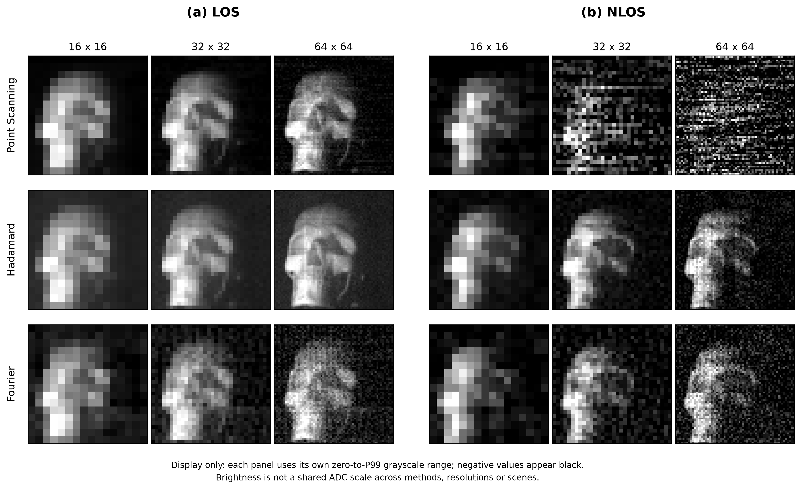
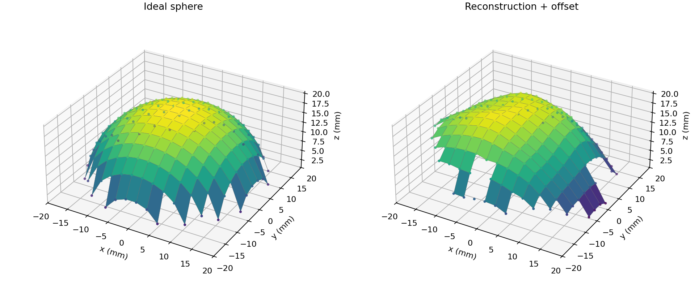
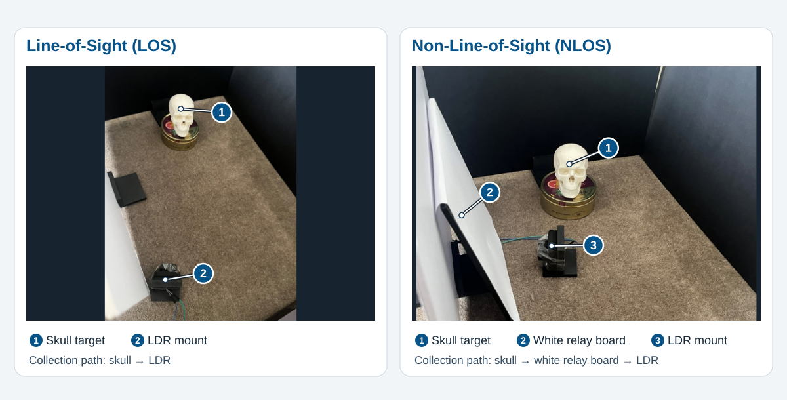
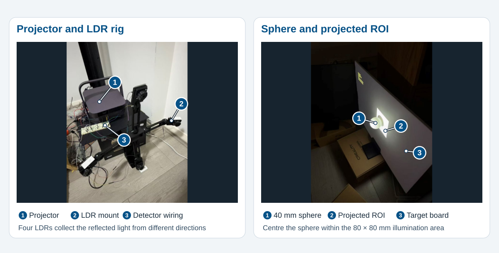

# Reflective Single-Pixel Imaging for 2D and 3D Reconstruction

MECH5720 major project. A projector illuminates the target with a sequence of patterns, and an Arduino UNO records the light reflected to one or more light-dependent resistors (LDRs). The 2D experiments compare point scanning, Hadamard and Fourier imaging under direct and indirect collection. The 3D experiments use four detector directions to estimate surface normals and reconstruct relative height.

## Representative results

| 2D reconstruction under LOS and NLOS | 3D sphere reconstruction |
| --- | --- |
|  |  |

The 3D example uses a 32 × 32 Hadamard capture of a 40 mm sphere. The height RMSE over the full front footprint was **3.17 mm after constant height offset alignment**, with valid heights at 203 of 208 reference pixels. See the [3D evaluation metrics](imaging_3d/datasets/hadamard_capture/intermediate_data/08_evaluate_sphere/metrics.csv).

## Reproduce the paper’s 2D comparison figure

From the repository root in PowerShell, install the offline dependencies and run the [figure script](analyze/reconstruction_comparison.py). It reads 18 saved reconstruction arrays from the repository and generates `analyze/report_results/reconstruction_comparison.png`. The regenerated PNG includes a note about grayscale scaling beneath the panels.

```powershell
python -m pip install numpy matplotlib
python .\analyze\reconstruction_comparison.py
```

## Build the setup

Use the [linked parts list](#parts-list) below for the projector, Arduino, LDRs, 22 kΩ resistors and board materials. The [CAD and STL files](model/) include detector, lens and board holders. Use a skull target for the 2D comparison and a 40 mm sphere on a flat white board for the included 3D experiment.

1. **Assemble the detector circuit.** Make one voltage divider per channel with the LDR between 5 V and the analogue input, and a 22 kΩ resistor between the input and GND. Mount the detector so it stays fixed during capture.
2. **Select the firmware.** For 2D, connect the divider output to A0 and upload the [single-channel sketch](ldr_acquisition/ldr_acquisition.ino). For 3D, use one divider on each of A0–A3 and upload the [four-channel sketch](ldr_acquisition/ldr_acquisition_with_four_ldr.ino/ldr_acquisition_with_four_ldr.ino.ino). Facing the sphere, the channel order is right, bottom, top and left.
3. **Arrange the target and collection path.** In LOS, aim the detector towards the skull. In NLOS, aim it at the white relay board so it collects relayed light from the skull. Keep the projector aimed at the skull in both configurations.



4. **Align the projector.** Use Windows extended display mode. For 3D, centre the sphere in the projected region of interest (ROI). The included sphere run used an 80 × 80 mm region. Keep the projector, target and detectors fixed once aligned.



## Capture and reconstruct

Install the hardware capture dependencies from the repository root.

```powershell
python -m pip install numpy matplotlib opencv-python pyserial screeninfo
```

**2D capture.** Set `PROJECTOR_INDEX` in the ROI calibration script to match the projector. Run it from `cali/` so the saved ROI goes to `cali/roi_calibration.json`. Use **W/A/S/D** to move the ROI, **J/L** and **K/I** to resize it, **P** to save and **Q** to exit.

```powershell
Push-Location .\cali
python .\02_roi_calibration.py
Pop-Location
```

Set `SERIAL_PORT`, `PROJECTOR_INDEX` and `GRID_SIZE` at the top of the selected capture script. Run one of the following from the repository root. Each writes a timestamped run to its corresponding `*_results/` directory.

```powershell
python .\point_scanning.py
python .\hadamard_imaging.py
python .\fourier_imaging.py
```

**3D capture and evaluation.** Use the [3D workflow](imaging_3d/README.md) to list devices, check a planned acquisition with `--dry-run`, capture into `imaging_3d/datasets/` and run stages 04, 05 and 08. Per-run CSV/JSON outputs stay with the dataset under `intermediate_data/`. PNG figures go to `imaging_3d/results/`.

## Known pitfalls

- **Serial connection.** Close Arduino Serial Monitor before running Python. The 2D script sends measurement commands, while the 3D script expects a stream from all four inputs. Use the firmware for the selected workflow.
- **Projector and ROI.** Confirm the display index and ROI before starting a long capture. Moving the projector, target or relay board after alignment changes the measurement geometry.
- **LDR settling and drift.** Keep ambient lighting stable, allow the configured settling time and retain the black reference frames used for background correction. Check the signal range and channel stability before a full run.
- **Result interpretation.** The 2D comparison scales each display panel separately. The 3D result is a relative surface height and its reported error is calculated after a constant height offset alignment.

## Repository map

| Location | Contents |
| --- | --- |
| `point_scanning.py`, `hadamard_imaging.py`, `fourier_imaging.py` | 2D acquisition and reconstruction |
| `cali/`, `ldr_acquisition/`, `model/` | Calibration, Arduino firmware and mechanical parts |
| `*_results/`, `analyze/` | Saved 2D data, analysis scripts and report figures |
| `imaging_3d/` | Four-channel capture, surface reconstruction, datasets and results |

---

# Reflective Single-Pixel Imaging — Calibration

This project uses a projector to illuminate a reflective target and a light-dependent resistor (LDR) to measure the returned light. A Python program controls the projected patterns, while an Arduino UNO records the LDR voltage and sends measurements to the computer over USB serial.

This README covers the hardware setup and calibration workflow: electrical response, projector alignment, temporal response, measurement repeatability, spatial response, and acquisition timing.

The scripts described below are restored versions of the calibration programs. They preserve the documented measurement methods but have not yet been revalidated on the hardware after restoration. Recorded settings are starting points for reproducing the setup, rather than universal calibration values.

<!-- IMAGE: 在这里放实验装置全景照片，标出 projector、reflective target、LDR、Arduino 和 computer，以及照明和反射光路。建议路径：docs/images/setup_overview.jpg。照片添加后取消下一行注释。 -->
<!--  -->

## Parts List

The quantities below describe one detector channel.

| Component | Quantity | Specification | Purchase link |
|---|---:|---|---|
| Projector | 1 | XGIMI Z7 | https://xgimi.com.au/product/xgimi-elfin-flip-laser-portable-projector-1600-iso-rgb-triple-laser-google-tv-netflix-harman-kardon-audio/ |
| Arduino | 1 | Arduino UNO R3 Board | https://www.jaycar.com.au/duinotech-uno-r3-main-board/p/XC4410  |
| LDR | 3 | Large Light Dependent Resistor (LDR) | https://www.jaycar.com.au/large-light-dependent-resistor-ldr/p/RD3485 |
| Resistor | 3 | 22 kΩ | https://www.jaycar.com.au/22k-ohm-0-5-watt-metal-film-resistors-pack-of-8/p/RR0604 |
| Tracing Paper | 1 | | https://www.officeworks.com.au/shop/officeworks/p/studymate-a4-tracing-pad-50-leaf-orange-smtrce50r?region_id=GTYP6H&regionIdSet=true |
| Foam Board | 3 |  | https://www.officeworks.com.au/shop/officeworks/p/a3-foam-board-5mm-white-ljpcfba3we |
